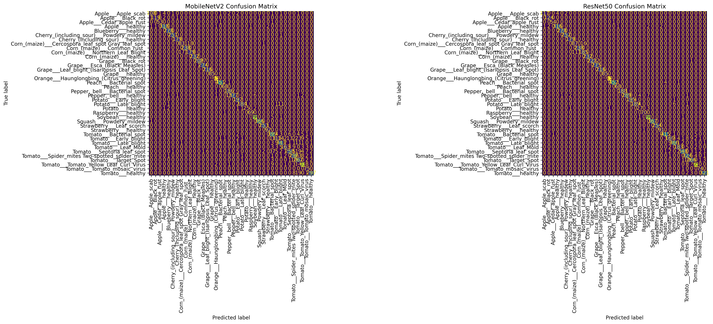
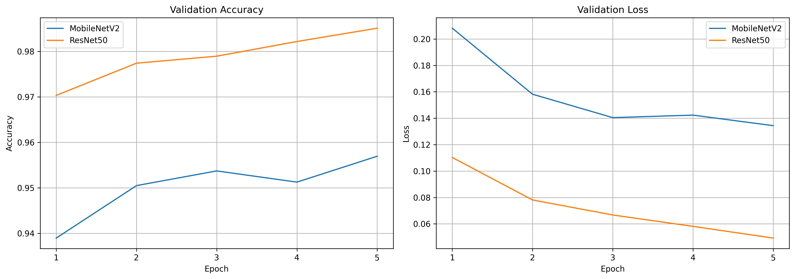

# AI-Based Crop Disease Detection Using Leaf Images

## Project Overview

This project explores the use of deep learning to classify plant diseases from leaf images.

Using the PlantVillage dataset, I developed and compared two convolutional neural network architectures, MobileNetV2 and ResNet50, using transfer learning.

The project evaluates their classification performance across 38 plant disease and healthy-leaf categories.

## Objectives

- Develop deep learning models for multi-class plant disease classification.
- Apply transfer learning using MobileNetV2 and ResNet50.
- Compare model performance using accuracy, loss, and F1-scores.
- Examine the potential and limitations of image-based plant disease detection.

## Dataset

The project uses the PlantVillage dataset, containing 54,304 images across 38 classes.

The data was divided into:
- Training set: 43,356 images before the training/validation split.
- Validation set: 6,504 images.
- Test set: 10,948 images.

The training data was further divided into training and validation subsets using stratified sampling.

## Models

- **MobileNetV2:** A lightweight convolutional neural network architecture.
- **ResNet50:** A deeper residual network architecture.

Both models were developed using transfer learning.

## Results

| Metric | MobileNetV2 | ResNet50 |
|---|---:|---:|
| Test Accuracy | 94.75% | 97.97% |
| Test Loss | 0.1569 | 0.0673 |
| Macro F1-score | 93.52% | 97.02% |
| Weighted F1-score | 94.69% | 97.97% |

ResNet50 achieved higher classification performance across the reported evaluation metrics.

### Confusion Matrices

The confusion matrices show the classification performance of both models across the 38 classes.



### Training and Validation Curves

The following plots show the validation accuracy and validation loss during model training.



## Technologies Used

- Python
- TensorFlow / Keras
- Hugging Face Datasets
- NumPy
- Pandas
- Matplotlib
- Seaborn
- Scikit-learn
- Google Colab

## Repository Structure

```text
plant-disease-detection/
│
├── notebooks/
│   └── crop_disease_detection.ipynb
│
├── requirements.txt
└── README.md
```

## Limitations

The models were evaluated using the PlantVillage test set. Performance on images captured in real-world agricultural environments may differ due to variations in lighting, backgrounds, image quality, and plant conditions.

Further testing with real-world leaf images would be necessary to assess generalisation.

## Future Improvements

- Evaluate the models using images captured outside controlled dataset conditions.
- Explore model optimisation for mobile or resource-constrained devices.
- Investigate integrating an explainability or information-retrieval component to provide farmers with more understandable predictions.
